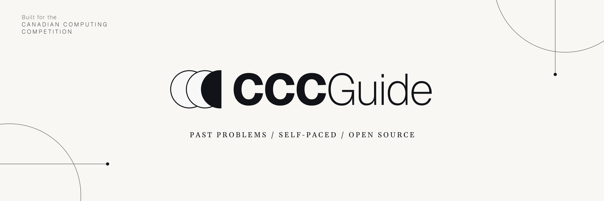

# CCC Guide

  

We aim to build an open, comprehensive guide for learning and preparing for the Canadian Computing Competition (CCC) and make an impact in the competitive programming and open-source communities.

## Contributing
CCC Guide is in its early stages, and your contribution is welcome! To get started, browse [Issues](https://github.com/Moreallure/ccc-guide/issues) to find areas that need improvement, or open a new issue to share your ideas, report a problem, or suggest a feature. See [CONTRIBUTING.md](CONTRIBUTING.md) for contribution guidelines.

## Tech Stack
- Next.js
- React
- Fumadocs
- Tailwind CSS

## License
The CCC Guide source code is licensed under the [MIT License](LICENSE).

Original educational content created for CCC Guide is licensed under [CC BY-NC-SA 4.0](LICENSE), except unless otherwise indicated.

Third-party materials, including contest problems and illustrations from CEMC, remain subject to their respective copyrights and terms.