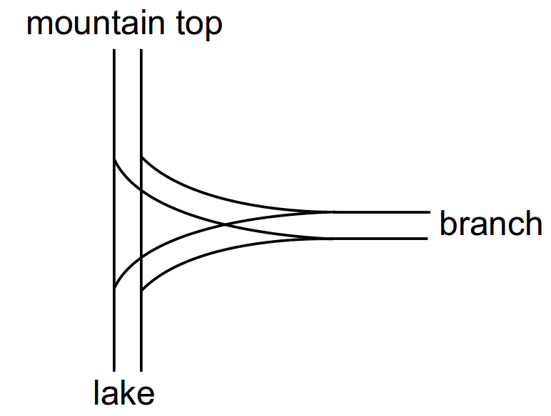
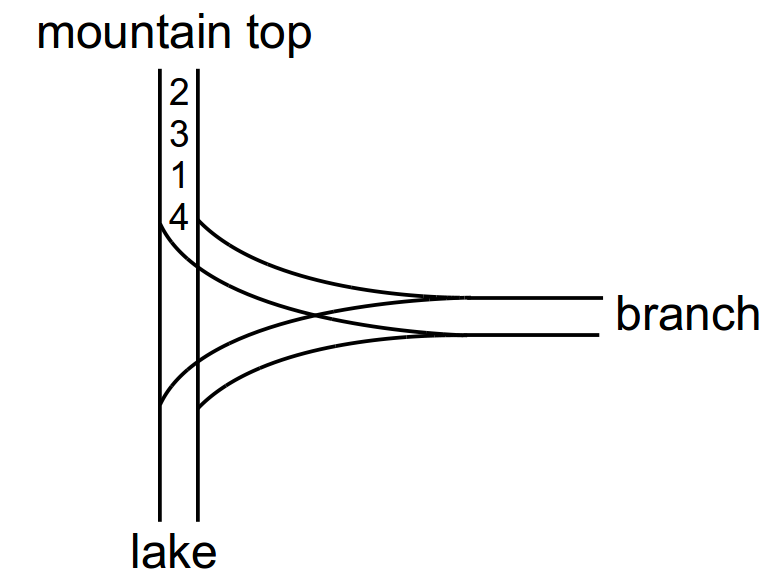

## Problem S3: The Geneva Confection

### Problem Description

In order to ensure peace and prosperity for future generations, the United Nations is creating the world’s largest candy. The ingredients must be taken in railway cars from the top of a mountain and poured into Lake Geneva. The railway system goes steeply from the mountaintop down to the lake, with a T-shaped branch in the middle as shown below.



Right now, each of the \\(N\\) ingredients is in its own railway car. Each railway car is assigned a positive integer from \\(1\\) to \\(N\\). The ingredients must be poured into the lake in the order \\(1,2,3,\\ldots,N\\) but the railway cars are lined up in some random order. The difficulty is that, because of the especially heavy gravity today, you can only move cars downhill to the lake, or sideways on the branch line. Is it still possible to pour the ingredients into the lake in the order \\(1,2,3,\\ldots,N\\) ?

For example, if the cars were in the order \\(2, 3, 1, 4\\), we can slide these into the lake in order as described below:



-   Slide car 4 out to the branch
-   Slide car 1 into the lake
-   Slide car 3 out to the branch
-   Slide car 2 into the lake
-   Slide car 3 from the branch into the lake
-   Slide car 4 from the branch into the lake

### Input Specification

The first line will contain the number \\(T\~(1 \\leq T \\leq 10)\\) which is the number of different tests that will be run. Each test has the form of an integer \\(N\~(1 \\leq N \\leq 100\\ 000)\\) on the first line of the test, followed by a list of the \\(N\\) cars listed from top to bottom. The cars will always use the numbers from 1 to \\(N\\) in some order.

### Output Specification

For each test, output one line which will contain either `Y` (for "yum") if the recipe can be completed, and `N` otherwise.

#### Sample Input

```
2
4
2
3
1
4
4
4
1
3
2
```

#### Output for Sample Input

```
Y
N
```
