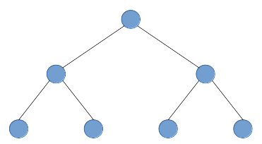
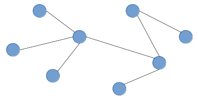
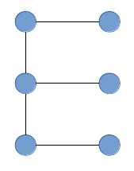
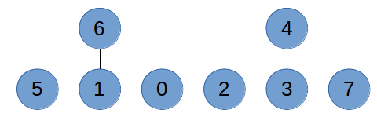

## Problem S3: Phonomenal Reviews

### Problem Description

Jo is a blogger, specializing in the critique of restaurants. Today, she wants to visit all the Vietnamese Pho restaurants in the Waterloo area, in order to determine which one is the best.

There are \\(N\\) restaurants in the city of Waterloo, numbered \\(0\\) to \\(N-1\\). However, only \\(M\\) of them are Pho restaurants. Jo can choose to start at any restaurant. There are \\(N-1\\) roads in Waterloo, each road connecting exactly two restaurants. It is possible to reach every restaurant from any restaurant using these roads. It takes Jo exactly 1 minute to travel along any road.

In computer science, a road network with this structure is called a _tree_. Here are three examples of trees:







One property that is true for _all_ trees is that there is exactly one path that does not repeat any roads between any two points in the tree.

What is the minimal length of time that Jo needs to spend on travelling on roads to visit all of the Pho restaurants?

### Input Specification

The first line of input contains 2 integers, \\(N\\) and \\(M\\) \\((2 \\leq M \\leq N \\leq 100\\ 000)\\).

The second line of input contains \\(M\\) distinct integers indicating the restaurants which are Pho restaurants.

The next \\(N\\)\-1 lines contain 2 integers each. The \\(i\\)\-th line contains \\(a_i\\) and \\(b_i\\), \\((0 \\leq a_i , b_i \\leq N-1)\\), representing a path between the two restaurants numbered \\(a_i\\) and \\(b_i\\).

For 3 of the 15 available marks, \\(M = 2\\) and \\(N \\leq 100\\).

For an additional 3 of the 15 available marks, \\(M \\leq 3\\) and \\(N \\leq 100\\).

For an additional 3 of the 15 available marks, \\(M \\leq 8\\) and \\(N \\leq 100\\).

For an additional 4 of the 15 available marks, \\(M \\leq N \\leq 1000\\).

### Output Specification

Your program should output one line, containing one integer - the minimum amount of time Jo needs to spend travelling on roads in order to visit all Pho restaurants, in minutes.

### Sample Input 1

```
8 2
5 2
0 1
0 2
2 3
4 3
6 1
1 5
7 3
```

#### Output for Sample Input 1

`3`

#### Explanation for Output for Sample Input 1

The path between \\(5\\) and \\(2\\) goes through \\(5 \\rightarrow 1 \\rightarrow 0 \\rightarrow 2\\), which uses 3 roads.

### Sample Input 2

```
8 5
0 6 4 3 7
0 1
0 2
2 3
4 3
6 1
1 5
7 3
```

#### Output for Sample Input 2

`7`

#### Explanation for Output for Sample Input 2

If Jo begins at restaurant 6, she will only need to use 7 roads. One possible path that she can take is: \\(6 \\to 1 \\to 0 \\to 2 \\to 3 \\to 7 \\to 3 \\to 4\\). Notice that she doesn’t need to visit restaurant 5, since it is not a Pho restaurant. A diagram of the road network is shown below:


