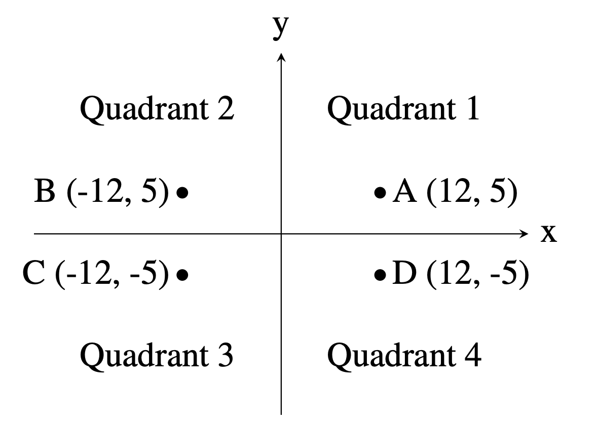

## Problem J1: Quadrant Selection

Time limit: 1 second

### Problem Description

A common problem in mathematics is to determine which quadrant a given point lies in. There are four quadrants, numbered from 1 to 4, as shown in the diagram below:



For example, the point A, which is at coordinates (12, 5) lies in quadrant 1 since both its \\(x\\) and \\(y\\) values are positive, and point \\(B\\) lies in quadrant 2 since its \\(x\\) value is negative and its \\(y\\) value is positive.

Your job is to take a point and determine the quadrant it is in. You can assume that neither of the two coordinates will be \\(0\\).

#### Input Specification

The first line of input contains the integer \\(x\\) \\((-1000 \\leq x \\leq 1000; x \\not= 0)\\). The second line of input contains the integer \\(y\\) \\((-1000 \\leq y \\leq 1000; y \\not= 0)\\).

#### Output Specification

Output the quadrant number (\\(1\\), \\(2\\), \\(3\\) or \\(4\\)) for the point \\((x,y)\\).

#### Sample Input 1

```
12
5
```

#### Output for Sample Input 1

`1`

#### Sample Input 2

```
9
-13
```

#### Output for Sample Input 2

`4`
