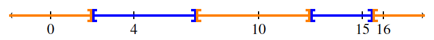

## Problem S1: Voronoi Villages

### Problem Description

In the country of Voronoi, there are \\(N\\) villages, located at distinct points on a straight road. Each of these villages will be represented by an integer position along this road.

Each village defines its _neighbourhood_ as all points along the road which are closer to it than to any other village. A point which is equally close to two distinct villages \\(A\\) and \\(B\\) is in the neighbourhood of \\(A\\) and also in the neighbourhood of \\(B\\).

Each neighbourhood has a _size_ which is the difference between the minimum (leftmost) point in its neighbourhood and the maximum (rightmost) point in its neighbourhood.

The neighbourhoods of the leftmost and rightmost villages are defined to be of infinite size, while all other neighbourhoods are finite in size.

Determine the smallest size of any of the neighbourhoods (with exactly 1 digit after the decimal point).

### Input Specification

The first line will contain the number \\(N\\) \\((3 \\leq N \\leq 100)\\), the number of villages. On the next \\(N\\) lines there will be one integer per line, where the \\(i\\)th line contains the integer \\(V_i\\), the position of the \\(i\\)th village \\((-1\\ 000\\ 000\\ 000 \\leq V_i \\leq 1\\ 000\\ 000\\ 000)\\). All villages are at distinct positions.

### Output Specification

Output the smallest neighbourhood size with exactly one digit after the decimal point.

#### Sample Input

```
5
16
0
10
4
15
```

#### Output for Sample Input

`3.0`

#### Explanation for Output for Sample Input

The neighbourhoods around \\(0\\) and \\(16\\) are infinite. The neighbourhood around 4 is \\(5\\) units (\\(2\\) to the left, and \\(3\\) to the right). The neighbourhood around 10 is \\(5.5\\) units (\\(3\\) to the left and \\(2.5\\) to the right). The neighbourhood around 15 is \\(3.0\\) units (\\(2.5\\) to the left and \\(0.5\\) to the right).


