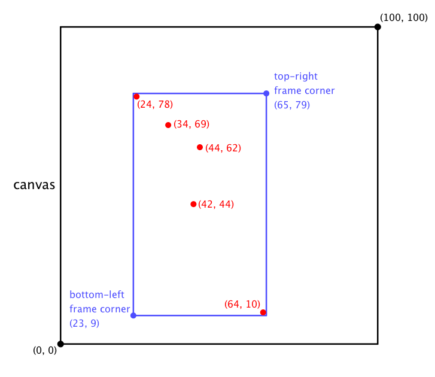

## Problem J3: Art

### Problem Description

Mahima has been experimenting with a new style of art. She stands in front of a canvas and, using her brush, flicks drops of paint onto the canvas. When she thinks she has created a masterpiece, she uses her 3D printer to print a frame to surround the canvas.

Your job is to help Mahima by determining the coordinates of the smallest possible rectangular frame such that each drop of paint lies inside the frame. Points on the frame are not considered inside the frame.

### Input Specification

The first line of input contains the number of drops of paint, \\(N\\), where \\(2 \\le N \\le 100\\) and \\(N\\) is an integer. Each of the next \\(N\\) lines contain exactly two positive integers \\(X\\) and \\(Y\\) separated by one comma (no spaces). Each of these pairs of integers represents the coordinates of a drop of paint on the canvas. Assume that \\(X \< 100\\) and \\(Y\< 100\\), and that there will be at least two distinct points. The coordinates \\((0,0)\\) represent the bottom-left corner of the canvas.

For 12 of the 15 available marks, \\(X\\) and \\(Y\\) will both be two-digit integers.

### Output Specification

Output two lines. Each line must contain exactly two non-negative integers separated by a single comma (no spaces). The first line represents the coordinates of the bottom-left corner of the rectangular frame. The second line represents the coordinates of the top-right corner of the rectangular frame.

### Sample Input

```
5
44,62
34,69
24,78
42,44
64,10
```

#### Output for Sample Input

```
23,9
65,79
```

#### Explanation of Output for Sample Input

The bottom-left corner of the frame is \\((23,9)\\). Notice that if the bottom-left corner is moved up, the paint drop at \\((64,10)\\) will not be inside the frame. (See the diagram below.) If the corner is moved right, the paint drop at \\((24,78)\\) will not be inside the frame. If the corner is moved down or left, then the frame will be larger and no longer the smallest rectangle containing all the drops of paint. A similar argument can be made regarding the top-right corner of the frame.


