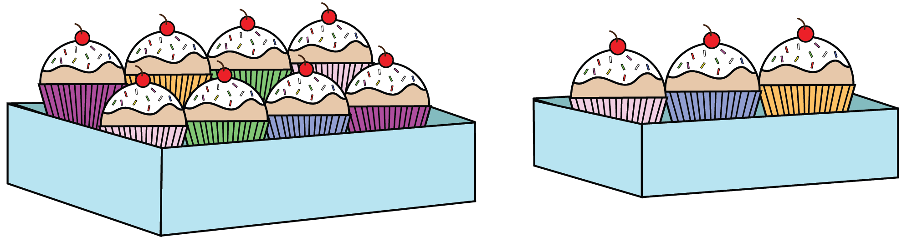

## Problem J1: Cupcake Party

### Problem Description

A regular box of cupcakes holds 8 cupcakes, while a small box holds 3 cupcakes. There are 28 students in a class and a total of at least 28 cupcakes. Your job is to determine how many cupcakes will be left over if each student gets one cupcake.



### Input Specification

The input consists of two lines.

-   The first line contains an integer \\(R\\geq 0\\), representing the number of regular boxes.
    
-   The second line contains an integer \\(S \\geq 0\\), representing the number of small boxes.
    

### Output Specification

Output the number of cupcakes that are left over.

### Sample Input 1

```
2
5
```

#### Output for Sample Input 1

```
3
```

#### Explanation of Output for Sample Input 1

The total number of cupcakes is \\(2\\times8 + 5\\times3\\) which equals 31. Since there are 28 students, there are 3 cupcakes left over.

### Sample Input 2

```
2
4
```

#### Output for Sample Input 2

```
0
```

#### Explanation of Output for Sample Input 2

The total number of cupcakes is \\(2\\times8 + 4\\times3\\) which equals 28. Since there are 28 students, there are no cupcakes left over.
