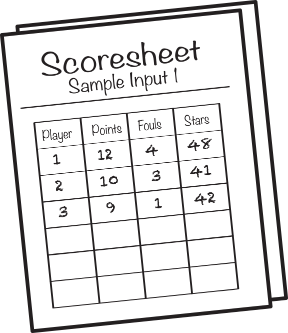
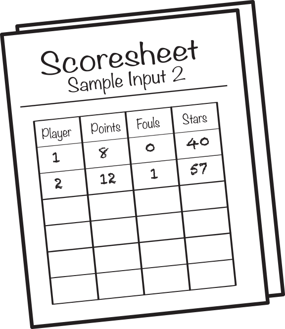

## Problem J2: Fergusonball Ratings

### Problem Description

Fergusonball players are given a star rating based on the number of points that they score and the number of fouls that they commit. Specifically, they are awarded \\(5\\) stars for each point scored, and \\(3\\) stars are taken away for each foul committed. For every player, the number of points that they score is greater than the number of fouls that they commit.

Your job is to determine how many players on a team have a star rating greater than \\(40\\). You also need to determine if the team is considered a gold team which means that _all_ the players have a star rating greater than \\(40\\).

### Input Specification

The first line of input consists of a positive integer \\(N\\) representing the total number of players on the team. This is followed by a pair of consecutive lines for each player. The first line in a pair is the number of points that the player scored. The second line in a pair is the number of fouls that the player committed. Both the number of points and the number of fouls, are non-negative integers.

### Output Specification

Output the number of players that have a star rating greater than \\(40\\), immediately followed by a plus sign if the team is considered a gold team.

### Sample Input 1

```
3
12
4
10
3
9
1
```

#### Output for Sample Input 1

```
3+
```

#### Explanation of Output for Sample Input 1

The image shows the star rating for each player. For example, the star rating for the first player is \\(12 \\times 5 - 4 \\times 3 = 48\\).



All three players have a rating greater than \\(40\\) so the team is considered a gold team.

### Sample Input 2

```
2
8
0
12
1
```

#### Output for Sample Input 2

```
1
```

#### Explanation of Output for Sample Input 2

The image shows the star rating for each player.



Since only one of the two players has a rating greater than \\(40\\), this team is not considered a gold team.
