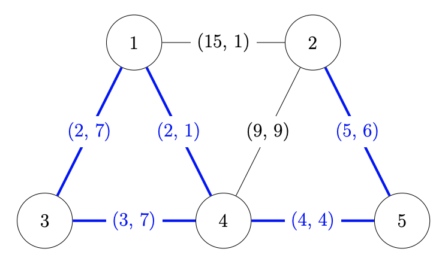

## Problem S4: Minimum Cost Roads

### Problem Description

As the newly elected mayor of Kitchener, Alanna’s first job is to improve the city’s road plan.

Kitchener’s current road plan can be represented as a collection of \\(N\\) intersections with \\(M\\) roads, where the \\(i\\)\-th road has length \\(l_i\\) meters, costs \\(c_i\\) dollars per year to maintain, and connects intersections \\(u_i\\) and \\(v_i\\). To create a plan, Alanna must select some subset of the \\(M\\) roads to keep and maintain, and that plan’s cost is the sum of maintenance costs of all roads in that subset.

To lower the city’s annual spending, Alanna would like to minimize the plan’s cost. However, the city also requires that she minimizes travel distances between intersections and will reject any plan that does not conform to those rules. Formally, for any pair of intersections \\((i, j)\\), if there exists a path from \\(i\\) to \\(j\\) taking \\(l\\) meters on the existing road plan, Alanna’s plan must also include a path between those intersections that is at most \\(l\\) meters.

### Input Specification

The first line contains the integers \\(N\\) and \\(M\\).

Each of the next \\(M\\) lines contains the integers \\(u_i\\), \\(v_i\\), \\(l_i\\), and \\(c_i\\), meaning that there currently exists a road from intersection \\(u_i\\) to intersection \\(v_i\\) with length \\(l_i\\) and cost \\(c_i\\) \\((1 \\le u_i, v_i \\le N, u_i \\neq v_i)\\).

The following table shows how the available 15 marks are distributed.

| Marks | Bounds on<br />\\(N\\) and \\(M\\) | Bounds on \\(l_i\\) | Bounds on \\(c_i\\) | Additional Constraints |
| --- | --- | --- | --- | --- |
| \\(3\\) marks | \\(1 \\le N, M \\le 2\\,000\\) | \\(l_i = 0\\) | \\(1 \\le c_i \\le 10^9\\) | None |
| \\(6\\) marks | \\(1 \\le N, M \\le 2\\,000\\) | \\(1 \\le l_i \\le 10^9\\) | \\(1 \\le c_i \\le 10^9\\) | There is at most one road between any unordered pair of intersections. |
| \\(6\\) marks | \\(1 \\le N, M \\le 2\\,000\\) | \\(0 \\le l_i \\le 10^9\\) | \\(1 \\le c_i \\le 10^9\\) | None |

### Output Specification

Output one integer, the minimum possible cost of a road plan that meets the requirements.

### Sample Input

```
5 7
1 2 15 1
2 4 9 9
5 2 5 6
4 5 4 4
4 3 3 7
1 3 2 7
1 4 2 1
```

#### Output for Sample Input

`25`

#### Explanation of Output for Sample Input

Here is a diagram of the intersections along with a valid road plan with minimum cost.



Hide/Reveal Description of Diagram for S4 Explanation

Five circles are labelled 1, 2, 3, 4, and 5. The following pairs of circles are joined by lines, with each line labelled with a different ordered pair as indicated.

-   Circles 1 and 2; label \\((15,1)\\)
-   Circles 1 and 3; label \\((2,7)\\)
-   Circles 1 and 4; label \\((2,1)\\)
-   Circles 2 and 4; label \\((9,9)\\)
-   Circles 2 and 5; label \\((5,6)\\)
-   Circles 3 and 4; label \\((3,7)\\)
-   Circles 4 and 5; label \\((4,4)\\)

* * *

Each edge is labeled with a pair \\((l, c)\\) denoting that it has length \\(l\\) meters and cost \\(c\\) dollars. Additionally, the roads that are part of the plan are highlighted in blue, with a total cost of \\(7+1+6+7+4=25\\).

It can be shown that we cannot create a cheaper plan that also respects the city’s requirements.
