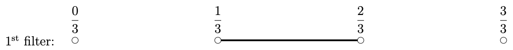
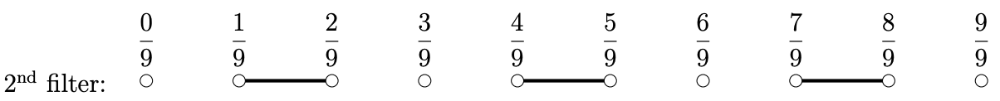
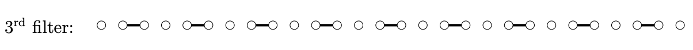
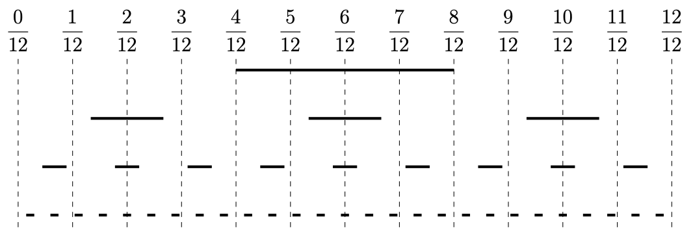

## Problem S5: The Filter

### Problem Description

Alice, the mathematician, likes to study real numbers that are between 0 and 1. Her favourite tool is the _filter_.

A filter covers part of the number line. When a number reaches a filter, two events can happen. If a number is not covered by the filter, the number will pass through. If a number is covered, the number will be removed.

Alice has infinitely many filters. Her first 3 filters look like this:







Hide/Reveal Description of Diagram for S5

All three filters are on a number line from 0 to 1.

The first filter has two additional points marked between \\(0\\) and \\(1\\) creating three intervals of equal length.  
The four marked points are labelled \\(\\frac\{0\}\{3\}\\), \\(\\frac\{1\}\{3\}\\), \\(\\frac\{2\}\{3\}\\), and \\(\\frac\{3\}\{3\}\\).  
The filter covers one of the intervals: between \\(\\frac\{1\}\{3\}\\) and \\(\\frac\{2\}\{3\}\\) (2nd interval).

The second filter has eight points marked between \\(0\\) and \\(1\\) creating nine intervals of equal length.  
The ten marked points are labelled \\(\\frac\{0\}\{9\}\\), \\(\\frac\{1\}\{9\}\\), \\(\\frac\{2\}\{9\}\\), \\(\\frac\{3\}\{9\}\\), \\(\\frac\{4\}\{9\}\\), \\(\\frac\{5\}\{9\}\\), \\(\\frac\{6\}\{9\}\\), \\(\\frac\{7\}\{9\}\\), \\(\\frac\{8\}\{9\}\\), and \\(\\frac\{9\}\{9\}\\).  
The filter covers three of the intervals: between \\(\\frac\{1\}\{9\}\\) and \\(\\frac\{2\}\{9\}\\) (2nd interval), between \\(\\frac\{4\}\{9\}\\) and \\(\\frac\{5\}\{9\}\\) (5th interval), and between \\(\\frac\{7\}\{9\}\\) and \\(\\frac\{8\}\{9\}\\) (eighth interval).

The third filter has twenty-six points marked between \\(0\\) and \\(1\\) creating twenty-seven intervals of equal length.  
The twenty-eight marked points are not labelled.  
The filter covers nine of the intervals: 2nd, 5th, 8th, 11th, 14th, 17th, 20th, 23rd, and 26th intervals.

* * *

In general, the \\(k\\)\-th filter can be defined as follows:

-   Consider the number line from 0 to 1.
    
-   Split this number line into \\(3^k\\) equal-sized pieces. There are \\(3^k+1\\) points and \\(3^k\\) intervals.
    
-   The \\(k\\)\-th filter consists of the 2nd interval, 5th interval, 8th interval, and in general, the \\((3i-1)\\)th interval. The points are **not** part of the \\(k\\)\-th filter.
    

Alice has instructions for constructing the _Cantor set_. Start with the number line from 0 to 1. Apply all filters on the number line, and remove the numbers that are covered. The remaining numbers form the Cantor set.

Alice wants to research the Cantor set, and she came to you for help. Given an integer \\(N\\), Alice would like to know which fractions \\(\\frac\{x\}\{N\}\\) are in the Cantor set.

### Input Specification

The first line contains the integer \\(N\\).

The following table shows how the available 15 marks are distributed.

| Marks | Bounds on \\(N\\) | Additional Constraints |
| --- | --- | --- |
| 3 marks | \\(3 \\le N \\le 3^\{18\}\\) | \\(N\\) is a power of \\(3\\) |
| 4 marks | \\(2 \\le N \\le 10^5\\) | None |
| 8 marks | \\(2 \\le N \\le 10^9\\) | None |

### Output Specification

Output all integers \\(x\\) where \\(0 \\le x \\le N\\) and \\(\\frac\{x\}\{N\}\\) is in the Cantor set.

Output the answers in increasing order. The number of answers will not exceed \\(10^6\\).

### Sample Input

`12`

#### Output for Sample Input

```
0
1
3
4
8
9
11
12
```

#### Explanation of Output for Sample Input

Here is a diagram of the fractions and the first 4 filters. In reality, there are infinitely many filters.



Hide/Reveal Description of Diagram for S5 Explanation

Thirteen equidistant points, \\(\\frac\{0\}\{12\}\\), \\(\\frac\{1\}\{12\}\\), \\(\\frac\{2\}\{12\}\\), \\(\\frac\{3\}\{12\}\\), \\(\\frac\{4\}\{12\}\\), \\(\\frac\{5\}\{12\}\\), \\(\\frac\{6\}\{12\}\\), \\(\\frac\{7\}\{12\}\\), \\(\\frac\{8\}\{12\}\\), \\(\\frac\{9\}\{12\}\\), \\(\\frac\{10\}\{12\}\\), \\(\\frac\{12\}\{12\}\\), and \\(\\frac\{11\}\{12\}\\), are in a line at the top of the digram. A dashed vertical line is drawn down from each of these of these points. The filters are placed along four different horizontal lines, passing across these lines.

-   The first filter covers one interval: between \\(\\frac\{4\}\{12\}\\) and \\(\\frac\{8\}\{12\}\\).
-   The second filter covers three intervals that are each one-third the length of the interval covered by the first filter. They are as follows:
    -   the first interval starts at a point one-third of the way from \\(\\frac\{1\}\{12\}\\) to \\(\\frac\{2\}\{12\}\\) and ends at a point two-thirds of the way from \\(\\frac\{2\}\{12\}\\) to \\(\\frac\{3\}\{12\}\\),
    -   the second interval starts at a point one-third of the way from \\(\\frac\{5\}\{12\}\\) to \\(\\frac\{6\}\{12\}\\) and ends at a point two-thirds of the way from \\(\\frac\{6\}\{12\}\\) to \\(\\frac\{7\}\{12\}\\), and
    -   the third interval starts at a point one-third of the way from \\(\\frac\{9\}\{12\}\\) to \\(\\frac\{10\}\{12\}\\) and ends at a point two-thirds of the way from \\(\\frac\{10\}\{12\}\\) to \\(\\frac\{11\}\{12\}\\).
-   The third filter covers nine intervals that are each one-third the length of the intervals covered by the second filter.
-   The fourth filter covers twenty-seven intervals that are each one-third the length of the intervals covered by the third filter.

* * *

\\(\\dfrac\{5\}\{12\}\\), \\(\\dfrac\{6\}\{12\}\\), and \\(\\dfrac\{7\}\{12\}\\) are not in the Cantor set because they were covered by the \\(1^\\text\{st\}\\) filter.

Furthermore, \\(\\dfrac\{2\}\{12\}\\) and \\(\\dfrac\{10\}\{12\}\\) are not in the Cantor set because they were covered by the \\(2^\\text\{nd\}\\) filter.

It can be shown that the remaining fractions will pass through all filters.
