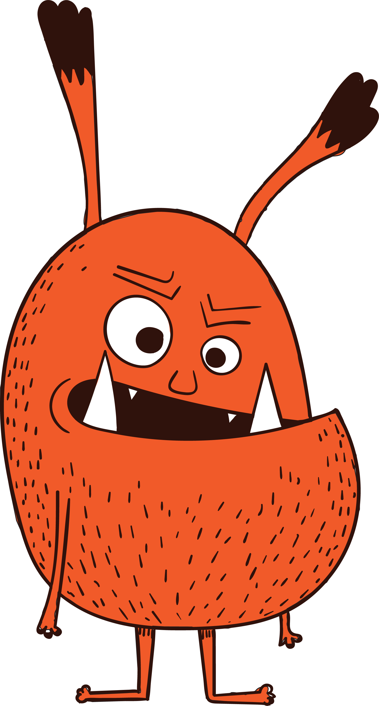
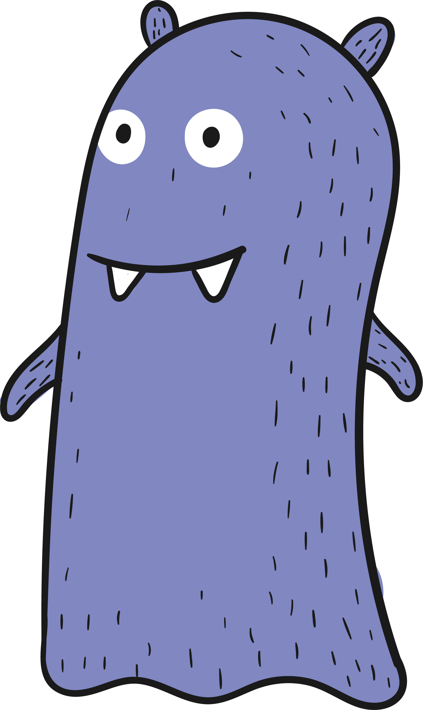

## Problem J2: Dusa And The Yobis

### Problem Description

Dusa eats Yobis, but only Yobis of a certain size.

If Dusa encounters a Yobi that is smaller than itself, it eats the Yobi, and absorbs its size. For example, if Dusa is of size \\(10\\) and it encounters a Yobi of size \\(6\\), Dusa eats the Yobi and expands to size \\(10+6=16\\).

If Dusa encounters a Yobi that is the same size as itself or larger, Dusa runs away without eating the Yobi.

Dusa is currently facing a line of Yobis and will encounter them in order. Dusa is guaranteed to eventually encounter a Yobi that causes it to run away. Your job is to determine Dusa’s size when this happens.

          

### Input Specification

The first line of input contains a positive integer, \\(D\\), representing Dusa’s starting size.

The remaining lines of input contain positive integers representing the sizes of the Yobis in order.

### Output Specification

Output the positive integer, \\(R\\), which is Dusa’s size when it eventually runs away.

### Sample Input 1

```
5
3
2
9 
20
22
14
```

#### Output for Sample Input 1

`19`

#### Explanation of Output for Sample Input 1

Dusa is large enough to eat the Yobi of size \\(3\\). This brings Dusa’s size to \\(8\\). Dusa is large enough to eat the Yobi of size \\(2\\). This brings Dusa’s size to \\(10\\). Dusa is large enough to eat the Yobi of size \\(9\\). This brings Dusa’s size to \\(19\\). The Yobi of size \\(20\\) causes Dusa to run away.

### Sample Input 2

```
10
10
3
5
```

#### Output for Sample Input 2

`10`

#### Explanation of Output for Sample Input 2

The Yobi of size \\(10\\) causes Dusa to run away, leaving its size unchanged.
