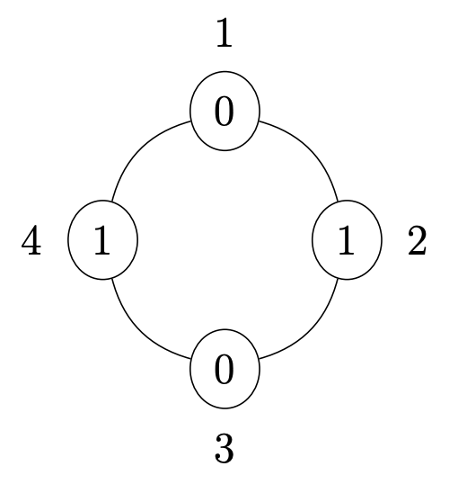
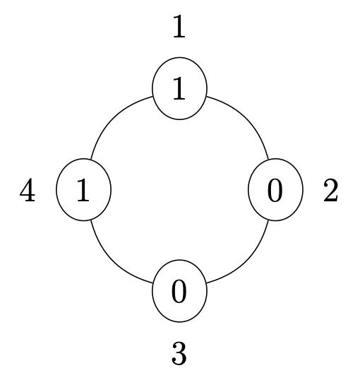

## Problem S1: Hat Circle

### Problem Description

At a recent social gathering, \\(N\\) people sit around a circular table, where \\(N\\) is even. The seats are numbered clockwise from \\(1\\) to \\(N\\). Each person is wearing a hat with a number on it. Specifically, the person at seat \\(i\\) is wearing a hat with the number \\(H_i\\) on it.

Each person looks at the person who is directly across (diametrically opposite) them in the circle.

Determine the number of people who see someone with a hat with the same number as their own.

### Input Specification

The first line of input will consist of one even positive integer \\(N\\), representing the number of people at the social gathering.

The next \\(N\\) lines each contain a single non-negative integer \\(H_i\\), representing the hat number of person \\(i\\).

The following table shows how the available \\(15\\) marks are distributed:

| Marks | Description | Bounds on \\(N\\) | Bounds on \\(H_i\\) |
| --- | --- | --- | --- |
| \\(2\\) | Very small number of people; only two hat numbers | \\(N \\le 4\\) | \\(H_i \\leq 1\\) |
| \\(1\\) | Only one hat number | \\(N \\le 100\\) | \\(H_i = 1\\) |
| \\(2\\) | People in even numbered seats have hat number 1; people in odd numbered seats have hat number 0 | \\(N \\le 100\\) | \\(H_i \\leq 1\\) |
| \\(5\\) | Medium number of people | \\(N \\le 2\\,000\\) | \\(H_i \\leq 4\\,000\\) |
| \\(5\\) | Large number of people and hat numbers | \\(N \\le 1\\,000\\,000\\) | \\(H_i \\le 2\\,000\\,000\\) |

### Output Specification

Output a single integer representing the number of people who see their hat number on the person directly across from them.

### Sample Input 1

```
4
0
1
0
1 
```

#### Output for Sample Input 1

`4`

#### Explanation of Output for Sample Input 1

The four seats around the table are shown below. Hat numbers are shown inside each seat and seat numbers are shown beside each seat.



Notice that every person sees their hat number. The people in seats \\(1\\) and \\(3\\) both see hat number \\(0\\), and the people in seats \\(2\\) and \\(4\\) both see hat number \\(1\\).

### Sample Input 2

```
4
1
0
0
1 
```

#### Output for Sample Input 2

`0`

#### Explanation of Output for Sample Input 2

The four seats around the table are shown below. Hat numbers are shown inside each seat and seat numbers are shown beside each seat.



Notice that no person sees their hat number. The people in seats \\(1\\) and \\(4\\) both see hat number \\(0\\), and the people in seats \\(2\\) and \\(3\\) both see hat number \\(1\\).
