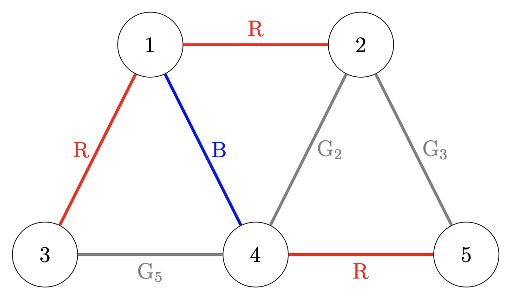

## Problem S4: Painting Roads

### Problem Description

Alanna, the mayor of Kitchener, has successfully improved the city’s road plan. However, a travelling salesperson from the city of RedBlue complained that the roads are not colourful enough. Alanna’s second job is to paint some of the roads.

Kitchener’s road plan can be represented as a collection of \\(N\\) intersections with \\(M\\) roads, where the \\(i\\)\-th road connects intersections \\(u_i\\) and \\(v_i\\). All roads are initially grey. Alanna would like to paint some of the roads in red or blue such that the following condition is satisfied:

-   Whenever there is a grey road that connects \\(u_i\\) and \\(v_i\\), there is also a path of roads from \\(u_i\\) to \\(v_i\\) such that the roads on the path alternate between red and blue, without any of the roads on this path being grey.
    

To lower the city’s annual spending, Alanna would like to minimize the number of painted roads. Can you help Alanna design a plan that meets all the requirements?

### Input Specification

The first line contains two integers \\(N\\) and \\(M\\) \\((1 \\le N,M \\le 2 \\cdot 10^5)\\).

The \\(i\\)\-th of the next \\(M\\) lines contains two integers \\(u_i\\) and \\(v_i\\), meaning that there exists a road from intersection \\(u_i\\) to intersection \\(v_i\\) \\((1 \\le u_i,v_i \\le N, u_i \\ne v_i)\\).

There is at most one road between any unordered pair of intersections.

The following table shows how the available 15 marks are distributed:

| Marks | Additional Constraints |
| --- | --- |
| \\(2\\) | There is a road connecting intersection \\(i\\) with intersection \\(i+1\\) for all \\(1 \\le i \< N\\) (and possibly other roads). |
| \\(3\\) | We can reach any intersection from any other intersection, and \\(N=M\\). |
| \\(3\\) | No road belongs to two or more simple cycles (see Definition below). |
| \\(7\\) | None |

Definition: if we denote a road between intersections \\(u\\) and \\(v\\) as \\(u \\leftrightarrow v\\), then a _simple cycle_ is a sequence \\(w_1 \\leftrightarrow w_2\\leftrightarrow \\ldots \\leftrightarrow w_k \\leftrightarrow w_1\\) where \\(k \\geq 3\\) and all \\(w_i\\) are distinct.

### Output Specification

Output a string of \\(M\\) characters, representing the paint plan. The \\(i\\)\-th character should be `R` if the \\(i\\)\-th road is to be painted red, `B` if \\(i\\)\-th road is to be painted blue, or `G` (for "grey") if the \\(i\\)\-th road is to be left unpainted.

Remember that you must minimize the number of painted roads while satisfying the condition. If there are multiple possible such plans, output any of them.

### Sample Input 1

```
5 7
1 2
2 4
5 2
4 5
4 3
1 3
1 4
```

#### Output for Sample Input 1

`RGGRGRB`

#### Explanation of Output for Sample Input 1

A diagram of the intersections along with a valid paint plan that minimizes the number of painted roads is shown below. Note that the colours are shown on each road as R (red), B (blue), or G (grey).



All the unpainted roads satisfy the condition:

-   The \\(2\\)nd road, labelled G2, connects intersection \\(2\\) with intersection \\(4\\). The path through intersections \\(2,1,4\\) alternates red, blue.
    
-   The \\(3\\)rd road, labelled G3, connects intersection \\(5\\) with intersection \\(2\\). The path through intersections \\(5,4,1,2\\) alternates red, blue, red.
    
-   The \\(5\\)th road, labelled G5, connects intersection \\(4\\) with intersection \\(3\\). The path through intersections \\(4,1,3\\) alternates blue, red.
    

### Sample Input 2

```
4 2
1 2
3 4
```

#### Output for Sample Input 2

`BB`

#### Explanation of Output for Sample Input 2

Note that it is possible for Kitchener to be disconnected.
