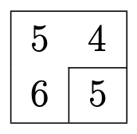

## Problem S5: Chocolate Bar Partition

### Problem Description

Maxwell has a chocolate bar that he wants to share with his friends. The chocolate bar can be represented as a \\(2\\) by \\(N\\) array of integers \\(T_\{i,j\}\\), the tastiness of each square. Maxwell would like to split the entire chocolate bar into connected parts such that the average (mean) tastiness of the chocolate bar is the same for each part. Maxwell would like to know what is the maximum number of connected parts he can split his chocolate bar into as described above.

A part is considered connected if you can visit every cell by moving up, down, left or right.

### Input Specification

The first line of input will consist of one positive integer \\(N\\), representing the length of the chocolate bar.

The second line of input contains \\(N\\) spaced integers representing the top row of the chocolate bar where the \\(j\\)\-th integer from the left represents \\(T_\{1,j\}\\).

Similarly, the third line of input contains \\(N\\) spaced integers representing the bottom row of the chocolate bar where the \\(j\\)\-th integer from the left represents \\(T_\{2,j\}\\).

The following table shows how the available \\(15\\) marks are distributed:

| Marks | Bounds on \\(N\\) | Bounds on \\(T_\{i,j\}\\) |
| --- | --- | --- |
| \\(2\\) | \\(N=2\\) | \\(0 \\le T_\{i,j\} \\leq 5\\) |
| \\(2\\) | \\(1 \\le N \\le 8\\) | \\(0 \\le T_\{i,j\} \\leq 20\\) |
| \\(1\\) | \\(1 \\le N \\le 20\\) | \\(0 \\le T_\{i,j\} \\leq 20\\) |
| \\(2\\) | \\(1 \\le N \\le 100\\) | \\(0 \\le T_\{i,j\} \\leq 20\\) |
| \\(2\\) | \\(1 \\le N \\le 1\\ 000\\) | \\(0 \\le T_\{i,j\} \\leq 100\\) |
| \\(3\\) | \\(1 \\le N \\le 2\\ 000\\) | \\(0 \\le T_\{i,j\} \\leq 100\\ 000\\) |
| \\(3\\) | \\(1 \\le N \\le 200\\ 000\\) | \\(0 \\le T_\{i,j\} \\leq 100\\ 000\\ 000\\) |

### Output Specification

Output a single integer, representing the maximum number of connected parts Maxwell can split his chocolate bar into.

### Sample Input 1

```
2
5 4
6 5
```

#### Output for Sample Input 1

`2`

#### Explanation of Output for Sample Input 1

An example of how to split this chocolate bar optimally into \\(2\\) parts is to have the bottom right corner as its own part and the rest of the chocolate as the second part, as shown below.



Each piece will have an average tastiness of \\(5\\).

### Sample Input 2

```
5
1 0 1 2 0
0 2 0 3 1  
```

#### Output for Sample Input 2

`5`

#### Explanation of Output for Sample Input 2

One way to get the optimal split is shown in the following picture:


Note that each piece has an average tastiness of \\(1\\).
