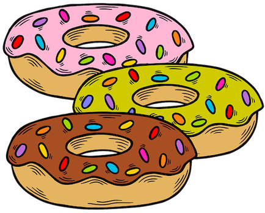

## Problem J2: Donut Shop

### Problem Description

The owner of a donut shop spends the day baking and selling donuts.

Given the events that happen over the course of the day, your job is to determine the number of donuts remaining when the shop closes.



### Input Specification

The first line of input contains a non-negative integer, \\(D\\), representing the number of donuts available when the shop first opens.

The second line contains a positive integer, \\(E\\), representing the number of events that happen over the course of the day. The next \\(E\\) pairs of input lines describe these events.

The first line in the pair contains either the `+` (plus) symbol, indicating that donuts have been baked, or the `-` (minus) symbol, indicating that donuts have been sold. The second line in the pair contains a positive integer, \\(Q\\), representing the quantity of donuts associated with the event.

For each sale of donuts, the value of \\(Q\\) will be less than or equal to the number of donuts available at that time.

### Output Specification

Output the non-negative integer, \\(R\\), which is the number of donuts remaining when the shop closes.

### Sample Input

```
10
3
+
24
-
6
-
```

#### Output for Sample Input

`16`

#### Explanation of Output for Sample Input

The shop opened with \\(10\\) donuts and there were \\(3\\) events during the day. The owner first baked \\(24\\) donuts. Then the owner sold \\(6\\) donuts, followed by another \\(12\\). The number of donuts remaining is \\(10+24-6-12=16\\).
