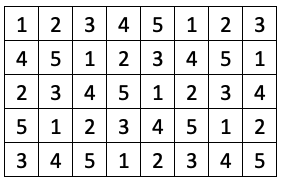
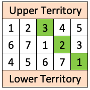

## Problem J5: Connecting Territories

### Problem Description

Ava is playing a strategic game on a grid of tiles. Each tile has an associated cost. When the costs of the tiles are read from left to right, starting with the first row, a repeating pattern of the first \\(M\\) positive integers in increasing order is revealed: \\(1, 2, 3, \\ldots, M, 1, 2, 3, \\ldots, M, 1, 2, 3, \\ldots\\). In this pattern, \\(M\\) represents the maximum cost of a tile. In the grid of tiles shown, \\(M\\) is equal to \\(5\\).



Ava needs to purchase one tile in each row in order to make a connecting path from the upper territory (above the first row of tiles) to the lower territory (below the last row of tiles). The first tile purchased must be in the first row. Each subsequently purchased tile must share either an edge or a corner with the tile purchased previously. In the grid of tiles shown, the cost of Ava’s connecting path is \\(9\\).


Given a grid of tiles, your job is to determine the minimum cost of a connecting path between the upper and lower territories.

### Input Specification

The first line of input contains a positive integer, \\(R\\), representing the number of rows in the grid. The second line contains a positive integer, \\(C\\), representing the number of columns in the grid. The third line contains a positive integer, \\(M\\) where \\(M \\leq 100\\,000\\), representing the maximum cost of a tile.

The following table shows how the available \\(15\\) marks are distributed:

| Marks | Description | Bounds |
| --- | --- | --- |
| \\(3\\) | There are two rows and at most ten columns. | \\(R=2\\) and \\(C \\leq 10\\) |
| \\(8\\) | There are at most ten rows and at most ten columns. | \\(R \\leq 10\\) and \\(C \\leq 10\\) |
| \\(2\\) | There are at most \\(100\\) rows and at most \\(100\\) columns. | \\(R \\leq 100\\) and \\(C \\leq 100\\) |
| \\(2\\) | The grid may be very large. | \\(R \\leq 20\\,000\\) and \\(C \\leq 20\\,000\\) |

### Output Specification

Output the positive integer, \\(P\\), which is the minimum cost of a connecting path between the upper and lower territories.

### Sample Input

```
3
5
7
```

#### Output for Sample Input

`6`

#### Explanation of Output for Sample Input

The cost of each tile is shown. The sequence of tiles that Ava should purchase to minimize the cost of a connecting path is highlighted in green.


