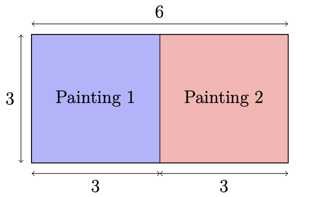
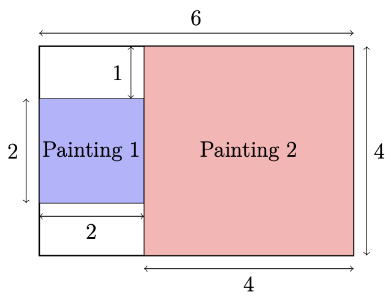

## Problem S1: Positioning Peter's Paintings

### Problem Description

Peter the painter just finished painting two rectangular paintings and would like to display both on a rectangular wall which has the smallest perimeter possible. The first painting has a base of length \\(A\\) units and a height of length \\(B\\) units. The second painting has a base of length \\(X\\) units and a height of length \\(Y\\) units.

Peter has a few conditions on how to arrange his paintings on the rectangular wall. The first condition is that the paintings must be upright, meaning that the bases of the paintings are parallel to the floor. The second condition is that he would like to display both paintings in full, meaning that they cannot overlap each other. Please help determine the rectangular wall of minimum perimeter such that the paintings can be displayed without violating his conditions.

### Input Specification

The one line of input will consist of four space-separated positive integers, \\(A\\), \\(B\\), \\(X\\), \\(Y\\) \\((1 \\le A, B, X, Y \\le 10^8)\\).

The following table shows how the available \\(15\\) marks are distributed:

| Marks | Brief Description |
| --- | --- |
| \\(5\\) | Paintings are congruent squares |
| \\(5\\) | Paintings are squares |
| \\(5\\) | Paintings are rectangles (possibly squares) |

### Output Specification

Output a single integer representing the minimum perimeter of a rectangular wall without violating Peter's conditions.

### Sample Input 1

`3 3 3 3`

#### Output for Sample Input 1

`18`

#### Explanation of Output for Sample Input 1

This test case satisfies all subtasks. An optimal arrangement using a 6-by-3 wall is shown below.

### Sample Input 2

`2 2 4 4`

#### Output for Sample Input 2

`20`

#### Explanation of Output for Sample Input 2

This test case satisfies the second and third subtasks. An optimal arrangement using a 6-by-4 wall is shown below.

### Sample Input 3

`1 2 3 1`

#### Output for Sample Input 3

`12`

#### Explanation of Output for Sample Input 3

This test case satisfies the last subtask. An optimal arrangement using a 3-by-3 wall is shown below.

