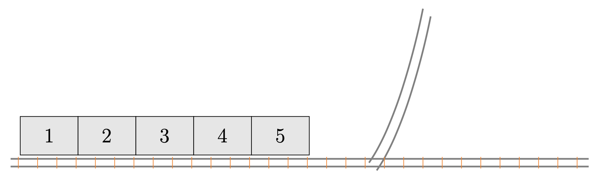
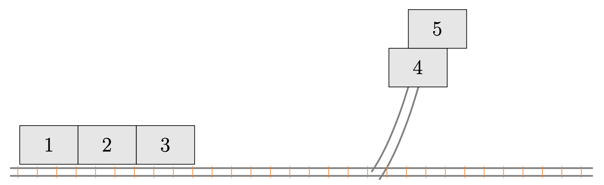
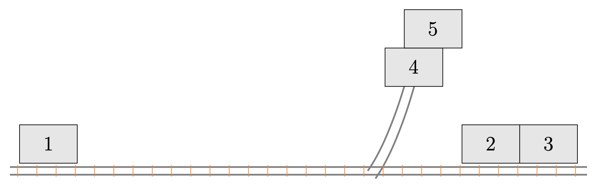
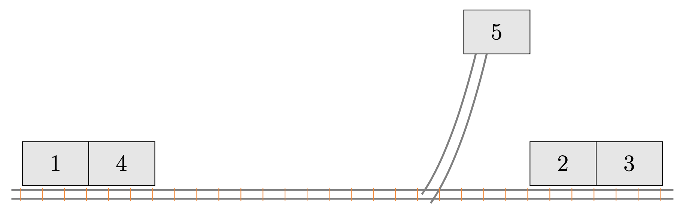

## Problem S4: Minecarts

### Problem Description

Steve has \\(N\\) minecarts labelled from \\(1\\) to \\(N\\) lined up on a track in a row from left to right. Initially, there are \\(a_i\\) gems in the \\(i\\)\-th minecart.

Steve wants the minecarts to be arranged in a row such that the number of gems in each minecart is non-decreasing from left to right. To do this, he plans to build a side track to the right of all of the minecarts that splits off from the main track. Steve can move minecarts that are on the left of the side track into the side track, allowing other minecarts on its left to move past it on the main track. Minecarts moved into the side track can be moved back into the main track one at a time: a minecart on the side track will move back to the left of the side track and to the right of all other minecarts which are on the left of the side track. The last minecart moved into the side track must be the first minecart to be moved back out: that is, the side track follows a last-in, first-out method. The side track can be used any number of times. Finally, once a minecart is moved to the right of the side track, it can no longer be moved to the left. Below is an example sequence of moves that can be made with \\(5\\) minecarts beginning from the initial position:









Steve has \\(K\\) spare gems, and he can distribute any number of them into the minecarts that are **empty**. Steve has yet to build the side track, and he wants to limit the side track capacity to save work. A side track with a specific capacity can only store up to that many minecarts. For example, if the side track had a capacity of \\(1\\), we would not be able to make the moves in the diagrams above, which would require a capacity of at least \\(2\\). Given that Steve places his spare gems into the minecarts optimally, what is the minimum capacity of the side track that needs to be built?

### Input Specification

The first line of input will consist of two space-separated integers \\(N\\) and \\(K\\) \\((1 \\leq N \\leq 3\\times10^5,\~ 0 \\leq K \\leq 10^\{12\})\\).

The next line contains \\(N\\) integers \\(a_1,\\dots,a_n\\) \\((0\\leq a_i\\leq 10^6)\\), where the \\(i\\)\-th integer indicates the number of gems in the \\(i\\)\-th minecart.

The following table shows how the available \\(15\\) marks are distributed:

| Marks | Bounds on \\(N\\) | Bounds on \\(K\\) |
| --- | --- | --- |
| \\(2\\) | \\(1\\leq N \\leq 5\\,000\\) | \\(K = 0\\) |
| \\(2\\) | \\(1\\leq N \\leq 5\\,000\\) | \\(K = 10^\{12\}\\) |
| \\(2\\) | \\(1\\leq N \\leq 5\\,000\\) | \\(0\\leq K \\leq 10^\{12\}\\) |
| \\(3\\) | \\(1\\leq N \\leq 3\\times10^5\\) | \\(K = 0\\) |
| \\(3\\) | \\(1\\leq N \\leq 3\\times10^5\\) | \\(K = 10^\{12\}\\) |
| \\(3\\) | \\(1\\leq N \\leq 3\\times10^5\\) | \\(0\\leq K \\leq 10^\{12\}\\) |

### Output Specification

Output a single integer, the minimum capacity of the side track that needs to be built given that Steve distributes up to \\(K\\) gems among the empty minecarts optimally.

### Sample Input 1

```
4 14 
5 0 4 0
```

#### Output for Sample Input 1

```
1
```

#### Explanation of Output for Sample Input 1

One optimal distribution is to put \\(6\\) of the spare gems into minecart \\(2\\) and \\(7\\) of the spare gems into minecart \\(4\\). Note that this distribution does not use all of the spare gems.

We can then build a side track of capacity \\(1\\). We can then arrange the minecarts in non-decreasing order as follows:

1.  Move minecart \\(4\\) past the side track
    
2.  Move minecart \\(3\\) into the side track
    
3.  Move minecart \\(2\\) past the side track
    
4.  Move minecart \\(1\\) past the side track
    
5.  Move minecart \\(3\\) out of the side track
    
6.  Move minecart \\(3\\) past the side track
    

### Sample Input 2

```
4 8
5 0 4 0
```

#### Output for Sample Input 2

```
2
```

#### Explanation of Output for Sample Input 2

One optimal distribution is to put all \\(8\\) spare gems into minecart \\(4\\).

Then we can build a side track of capacity \\(2\\). We can then arrange the minecarts in non-decreasing order as follows:

1.  Move minecart \\(4\\) past the side track
    
2.  Move minecart \\(3\\) into the side track
    
3.  Move minecart \\(2\\) into the side track
    
4.  Move minecart \\(1\\) past the side track
    
5.  Move minecart \\(2\\) out of the side track
    
6.  Move minecart \\(3\\) out of the side track
    
7.  Move minecart \\(3\\) past the side track
    
8.  Move minecart \\(2\\) past the side track
    

### Sample Input 3

```
4 123456789 
40 30 20 10
```

#### Output for Sample Input 3

```
3
```

#### Explanation of Output for Sample Input 3

Since there are no empty minecarts, there is only one possible distribution of spare gems: no spare gems are used at all.

Then we can build a side track of capacity \\(3\\). We can then arrange the minecarts in non-decreasing order as follows:

1.  Move minecart \\(4\\) into the side track
    
2.  Move minecart \\(3\\) into the side track
    
3.  Move minecart \\(2\\) into the side track
    
4.  Move minecart \\(1\\) past the side track
    
5.  Move minecart \\(2\\) out of the side track and then past the side track
    
6.  Move minecart \\(3\\) out of the side track and then past the side track
    
7.  Move minecart \\(4\\) out of the side track and then past the side track
