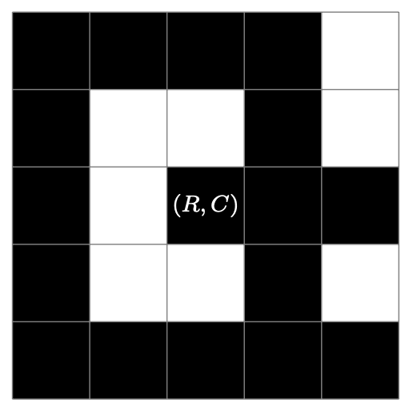
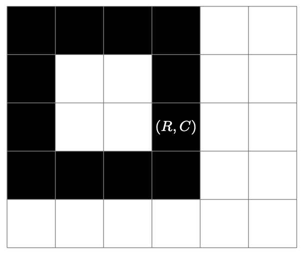
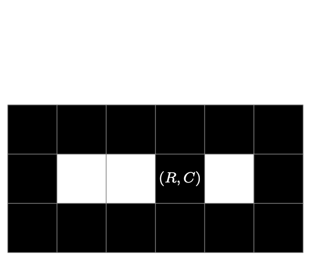

## Problem S5: On the Fence

### Problem Description

You recently inherited a beautiful plot of land, which can be viewed as a grid with \\(N\\) rows and \\(M\\) columns. Now you want to protect your land from trespassers by building a giant fence on it. You will build this fence by choosing up to \\(K\\) grid cells and filling each of them with a concrete block; these cells are _on the fence_. Due to mysterious construction laws, the cell in row \\(R\\) and column \\(C\\) must be on the fence. Also, the fence cells must form a _single connected component_—you should be able to get between any two cells on the fence by moving vertically or horizontally (_not_ diagonally) through fence cells only.

The cells in row \\(1\\), column \\(1\\), row \\(N\\), and column \\(M\\) are called _edge cells_. A cell not on the fence is _outside_ the fence if you can get from that cell to an edge cell by moving vertically, horizontally, _or_ diagonally, without going through any fence cells. Otherwise, the cell is _inside_ the fence. The figure below shows some examples of valid and invalid fences.



This is a valid fence made of \\(17\\) blocks, with \\(5\\) inside cells.


This fence is invalid because it is not connected.


This fence is valid, but it encloses zero inside cells.

You want to protect as much of your land as possible. Find the largest number of inside cells you can enclose within your fence.

### Input Specification

The first line of input contains an integer \\(T\\), the number of test cases in the input.

The next \\(T\\) lines each contain a test case, consisting of five space-separated integers: \\(N\\), \\(M\\), \\(K\\), \\(R\\), and \\(C\\) \\((1 \\le K \\le NM,\~ 1 \\le R \\le N,\~ 1 \\le C \\le M)\\).

The table on the next page shows how the available \\(15\\) marks are distributed.

| Marks | Bounds on \\(T\\) | Bounds on \\(N\\), \\(M\\) | Additional Constraints |
| --- | --- | --- | --- |
| \\(1\\) | \\(T \\le 1000\\) | \\(1 \\le N,M \\le 10^9\\) | \\(K=NM\\) |
| \\(2\\) | \\(T \\le 10\\) | \\(1 \\le N,M \\le 6\\) | None |
| \\(2\\) | \\(T \\le 10\\) | \\(1 \\le N,M \\le 40\\) | None |
| \\(2\\) | \\(T \\le 10\\) | \\(1 \\le N,M \\le 300\\) | None |
| \\(2\\) | \\(T \\le 10\\) | \\(1 \\le N,M \\le 2\\,000\\) | None |
| \\(3\\) | \\(T \\le 10\\) | \\(1 \\le N,M \\le 10^6\\) | None |
| \\(3\\) | \\(T \\le 1000\\) | \\(1 \\le N,M \\le 10^9\\) | None |

### Output Specification

Output \\(T\\) lines. The \\(t\\)\-th line should contain a single integer, the answer to test case \\(t\\).

### Sample Input

```
2
5 6 12 3 4
3 6 18 2 4
```

#### Output for Sample Input

```
4
3
```

#### Explanation of Output for Sample Input

Below are optimal fences for the two test cases, which enclose \\(4\\) and \\(3\\) inside cells, respectively:




